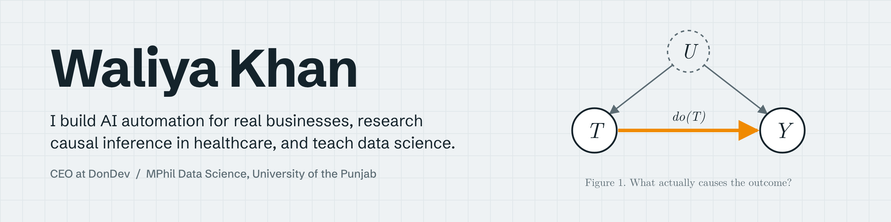

# Hi, I'm Waliya Khan

I build AI and automation systems for real businesses, research causal inference for healthcare, and help teach data science at the University of the Punjab in Lahore.

Most of my work comes back to one question: **what actually causes the outcome we care about?** In client work that means finding the manual step that slows a team down. In research it means separating real treatment effects from correlation in clinical data.

---

## What I'm doing now

| | |
|---|---|
| **Building** | CEO at [DonDev](https://www.dondev.tech/), an automation agency. We design workflow, voice, CRM, booking and payment systems for clients in the US, UK and Pakistan. I'm also Top Rated on Upwork. |
| **Researching** | MPhil in Data Science, University of the Punjab (CGPA 4.00). My thesis compares regression with causal inference for heart failure patients, using echocardiogram outcomes and treating procedures and medications as interventions. |
| **Teaching** | Teaching assistant for Big Data Analytics in my MPhil: I run labs, set and mark quizzes, and help keep the course in step with industry tools. During my bachelor's I was a teaching assistant for Programming Fundamentals, Object Oriented Programming and Introduction to Databases. |

Before this, I graduated with a **University Gold Medal** in Business and Information Technology (CGPA 3.99) from the same university.

---

## Selected work

### AI and data science

| Project | What it does | Stack |
|---|---|---|
| [Self-Reflective Fact-Checking Agent](https://huggingface.co/spaces/WaliyaKhan882/Self-Reflective-Fact-Checking-Agent) | A drafter answers a question, an extractor pulls out its claims, an auditor checks each claim against web search, and an editor rewrites a corrected answer with a visible audit trail. | LangGraph, Groq, DuckDuckGo, Gradio |
| [Web-Grounded Multimodal Assistant, v1 to v5](https://huggingface.co/WaliyaKhan882) | Five versions, each adding one capability: answers from scraped web pages, then YouTube transcripts, voice in and audio out, and image generation. | Hugging Face Spaces, Gradio, RAG |
| [AI and Data Science Salary Predictor](https://github.com/WaliyaKhan882/AI-Data-Science-Salary-Predictor) | EDA, preprocessing and a comparison of six regression models on AI/ML salaries across 10 countries, served through a Streamlit app. | Python, scikit-learn, Streamlit |
| [RAG PDF Chatbot](https://huggingface.co/spaces/WaliyaKhan882/RAG_CHATBOT) | Answers questions from uploaded PDFs using retrieval-augmented generation. | Python, Gradio, RAG |
| [DonDev Chatbot](https://github.com/WaliyaKhan882/Dondev-Chatbot) ([live](https://huggingface.co/spaces/WaliyaKhan882/Dondev_Chatbot)) | A sales assistant grounded in DonDev's service information, with a choice of Llama and Mixtral models. | Python, Gradio, Groq |

### Client automation systems

| Client | What I built | Stack |
|---|---|---|
| DiamondHoofCare | Order processing, inventory, deal creation and invoicing, cutting manual task effort by about 95%. | Make.com, Google Apps Script, ClickUp, Trellinator |
| Reese Villa (US) | End-to-end operations for a personal chef and villa events business: booking, proposals, client messaging, AI-assisted menus and team scheduling. | Make.com, Twilio, Trello, OpenAI |
| HermesLines | Sales, billing, subscriptions and fulfillment connected across payment, project and shipping tools. | Stripe, Monday.com, ShipStation |
| Legal intake | An AI voice agent that answers inbound legal enquiries around the clock. | n8n, Vapi |
| SocioGPT | Turns a short prompt into social media posts with images or video, with a human approval step before publishing. | Make.com, Gemini, Json2Video |

---

## Research

- **W. Khan**, W. Munir, F. Bukhari and T. Butt, "Effect of Wearable-Based Automated Interventions on Stress Reduction using Machine Learning," *IEEE iCoMET 2026*, Sukkur, Pakistan. [DOI: 10.1109/iCoMET69771.2026.11591768](https://doi.org/10.1109/iCoMET69771.2026.11591768)
- **MPhil thesis (in progress):** regression versus causal inference on real-world cardiology records, co-supervised with a US healthcare industry expert.

---

## Tools I work with

**Data science and AI:** Python, pandas, scikit-learn, regression, causal DAGs, RAG, LangGraph, Groq, OpenAI, Gemini, Hugging Face, Gradio, Streamlit

**Automation:** n8n, Make.com, Zapier, Google Apps Script, Vapi, Retell AI, ElevenLabs, Selenium, REST APIs, webhooks

**Data:** MySQL, SQLite, MongoDB, Cassandra, Neo4j, Redis, vector databases

**Languages:** Python, C, C++, Java, JavaScript, PHP

---

## Learning and teaching repositories

Practice code I wrote while learning, and now use when helping students with the fundamentals:
[Python](https://github.com/WaliyaKhan882/Python) · [Java](https://github.com/WaliyaKhan882/Java) · [C Language](https://github.com/WaliyaKhan882/C-language-IBIT) · [Data Structures and Algorithms](https://github.com/WaliyaKhan882/DSA)

---

## Where I'm heading

I want to do a PhD in causal inference for healthcare decision making, while continuing to build practical AI systems through DonDev.

---

## Contact

[LinkedIn](https://linkedin.com/in/waliyakhan) · [Hugging Face](https://huggingface.co/WaliyaKhan882) · [DonDev](https://www.dondev.tech/) · [waliyashahkhan@gmail.com](mailto:waliyashahkhan@gmail.com)
